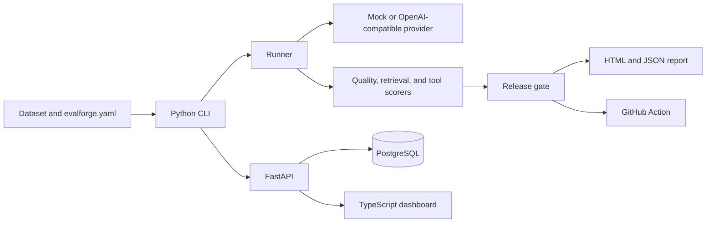

# EvalForge

EvalForge runs a dataset of questions against prompt and model targets, then blocks a release when quality falls, cost rises too far, or p95 latency crosses a threshold.

The checked-in benchmark uses a mock provider, so you can try the full path without API keys. Those numbers are not live model scores.

## Try it

The example compares two prompt versions, `support-v1` and `support-v2`, against [datasets/evalforge-qa-v1](datasets/evalforge-qa-v1/).

```bash
uv sync --all-packages --group dev
uv run evalforge run --config examples/ci/evalforge.yaml --out-dir out
```

Open `out/evalforge-report.html`. The command exits 0 when every target passes the gate and 1 when any target fails.

To browse runs in the dashboard:

```bash
docker compose up -d --build
uv run evalforge publish \
  --config examples/ci/evalforge.yaml \
  --results out/evalforge-results.json \
  --api-url http://localhost:8000 \
  --api-key dev-key
pnpm install
pnpm dev:web
```

Open http://localhost:5173. Enter `dev-key`, choose **Load runs**, then **Compare cases**. Target A and target B default to the two prompt versions. Quality stays at 1.000. `support-v2` costs more and has a higher p95 latency because its mock fixture uses more tokens.

| Service | URL |
| --- | --- |
| Dashboard | http://localhost:5173 |
| API health | http://localhost:8000/health |
| API key | `dev-key` |
| PostgreSQL | `localhost:5434` (`evalforge` / `evalforge`) |

`GET /health` is public. Every other route expects `Authorization: Bearer dev-key`.

## Architecture



The CLI is what CI runs. It does not need the API. `evalforge publish` stores the same JSON and HTML so the dashboard can list runs and diff targets.

| Piece | Role |
| --- | --- |
| `packages/evalforge` | Dataset hash, providers, scorers, RAG retriever, tool loop, gate, HTML report, CLI |
| `apps/api` | FastAPI history: datasets, runs, HTML report, target compare |
| `apps/web` | Quality-versus-cost chart and case diff |
| `action` | Runs the CLI, uploads `evalforge-report.html`, fails the job on a bad gate |
| `datasets/evalforge-qa-v1` | Original questions, expected answers, and a small corpus |
| `examples/ci` | Mock fixtures, two prompts, pricing, and the baseline the gate compares against |

## What the gate checks

`examples/ci/evalforge.yaml` sets four limits:

- `quality_min` — mean case quality must stay at or above this value
- `quality_drop_max` — how far quality may fall versus the baseline target of the same name
- `cost_increase_max` — relative cost increase versus that baseline
- `latency_p95_ms` — absolute p95 cap

Case quality is the mean of the scorers that apply:

- every case: normalized match, contains, and token F1
- RAG cases: recall of `expected_chunk_ids` from the lexical retriever
- tool cases: call order and argument subset against the fixture stubs

An optional LLM judge can be turned on in the config. Its score is stored on the case and is not mixed into the gate.

The run manifest records the dataset SHA-256, each prompt hash, the pricing-table version, the seed, and the temperature. The hash is computed from the case objects in file order, serialized as canonical JSON.

## API

- `POST /v1/datasets`
- `POST /v1/runs`
- `GET /v1/runs`
- `GET /v1/runs/{id}`
- `GET /v1/runs/{id}/report.html`
- `POST /v1/compare`

## GitHub Action

```yaml
- uses: astral-sh/setup-uv@v5
  with:
    python-version: "3.12"
- run: uv sync --all-packages
- uses: ./action
  with:
    config: examples/ci/evalforge.yaml
```

The action runs `uv run evalforge run`, uploads the HTML report, and fails the check when the gate fails. A `baseline` input overrides the baseline path in the config.

## Live providers

Set `provider: openai` on a target. The runner calls `POST /chat/completions` on an OpenAI-compatible base URL and sends the configured temperature and seed. Cost is computed from `pricing.yaml` and the token counts in the provider response. Put the key in `OPENAI_API_KEY`, or in the variable named by `api_key_env`.
